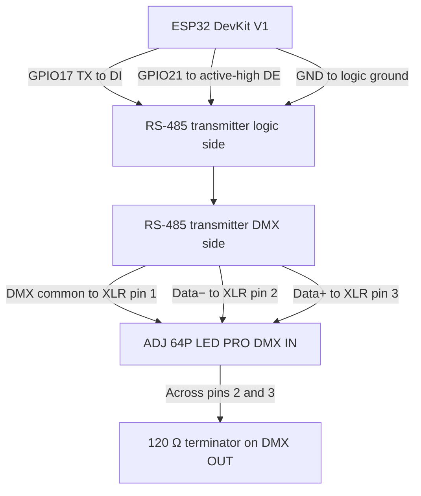

# Smart DMX

Smart DMX is ESP32 firmware that exposes a three-channel RGB DMX fixture as a Matter over Wi-Fi **Extended Color Light**. A compatible Matter controller can control power, brightness, hue, saturation and color temperature. The firmware approximates color temperature using RGB mixing. The reference setup was tested with Homey Self-Hosted Server.

**Signal path** · Matter controller → Matter over Wi-Fi → ESP32 → RS-485 transmitter → DMX fixture

The target setup is an ESP32 DevKit V1 with 4 MB flash and an ADJ 64P LED PRO in three-channel RGB mode. The default firmware runs in dry-run mode and logs the RGB output over USB. You can pair the ESP32 and test the controls before attaching a DMX transmitter.

| Feature | Validation |
| --- | --- |
| RGB conversion and DMX frame mapping | Covered by host-side C++ tests |
| Homey SHS pairing and direct lamp controls | Verified with dry-run firmware |
| Reconnection after an ESP32 restart | Verified with dry-run firmware |
| Physical DMX output and controller automations | Pending validation |

## 1. Gather the hardware

Start with the ESP32 and a micro-USB data cable. Add the RS-485 transmitter after confirming that your Matter controller can control the light.

| Item | Model and details | Status |
| --- | --- | --- |
| Matter controller | A controller that supports Matter over Wi-Fi and Extended Color Lights | Dry-run tested with Homey Self-Hosted Server |
| Development board | ESP32 DevKit V1, 30-pin board with ESP-WROOM-32 module, ESP32-D0WDQ6-V3 revision 3.0 and 4 MB flash | Identified and flashed |
| USB serial | On-board Silicon Labs CP2102 and micro-USB data cable | Used for flashing and serial logs |
| DMX fixture | American DJ 64P LED PRO with 3-pin XLR DMX IN (male) and DMX OUT (female) | Identified from the fixture label and rear panel |
| DMX transmitter | RS-485 transmitter with 3.3 V-compatible logic and active-high driver enable. It must support 250 kbit/s and pass the DMX break. An isolated unit is preferred for permanent use. | Required for physical DMX. Exact module unconfirmed |
| DMX cable and termination | 120 Ω DMX cable with female 3-pin XLR at the fixture input, plus a 120 Ω terminator at the last fixture | Required for physical DMX |

## 2. Install the toolchain

Use Linux or WSL2. On Ubuntu, install the build prerequisites:

```sh
sudo apt-get update
sudo apt-get install -y git wget flex bison gperf python3 python3-pip python3-venv \
  cmake ninja-build ccache libffi-dev libssl-dev dfu-util libusb-1.0-0 \
  build-essential pkg-config libdbus-1-dev libglib2.0-dev unzip
```

Install ESP-IDF **v5.4.1** for the classic `esp32` target and ESP-Matter at the pinned revision. Do this in a directory where you want to keep the SDKs:

```sh
git clone --branch v5.4.1 --recursive https://github.com/espressif/esp-idf.git
(cd esp-idf && ./install.sh esp32)
. ./esp-idf/export.sh

git clone --no-checkout https://github.com/espressif/esp-matter.git
cd esp-matter
git checkout 4957e8331fbbed67d7b52010458fa59eab82a921
git submodule update --init --depth 1
(cd connectedhomeip/connectedhomeip && ./scripts/checkout_submodules.py --platform esp32 linux --shallow)
./install.sh --no-host-tool
. ./export.sh
cd ..
```

For later terminal sessions, source both SDKs' `export.sh` files in the same order. Use their absolute paths if you are in another directory. WSL2 users need to make the USB serial device available to Linux before flashing.

## 3. Build and flash in dry-run mode

Connect the ESP32 by USB. Identify the serial port, commonly `/dev/ttyUSB0` for a CP2102 on Linux, and check the reported flash size. Use at least **4 MB**. Back up any existing firmware and device state you need before replacing it.

```sh
port=/dev/ttyUSB0
python -m esptool --port "$port" flash_id

git clone https://github.com/FML21/Smart-DMX.git
cd Smart-DMX/firmware/matter-dmx
idf.py -B build -DIDF_TARGET=esp32 build
idf.py -B build -p "$port" flash monitor
```

Use your own serial port in place of the example. `idf.py flash` uses the generated offsets for the bootloader, partition table and application. The serial console runs at 115200 baud. Expect a dry-run message and a Matter setup code. Keep the code and serial logs private. The dry-run firmware logs RGB values and leaves the DMX GPIO pins unused.

If the flash tool cannot connect, close other serial monitors, check your USB cable and port permissions, and retry. If the board does not enter the bootloader automatically, hold **BOOT**, tap **EN**, and release **BOOT** before retrying.

## 4. Pair and test with a Matter controller

1. Put your Matter controller and the ESP32 on the same local network for the first test. The ESP32 needs 2.4 GHz Wi-Fi. Local IPv6 and multicast discovery must be available. Keep your phone close to the ESP32 for Bluetooth commissioning.
2. In your controller's app, choose the option to add a Matter device. Use the QR or manual code from the serial console. The firmware uses SDK test provisioning, and acceptance depends on the controller.

   On Homey Self-Hosted Server, open **Devices → + → New Device → Matter** in the Homey mobile app.
3. Switch the light on, dim it, and try red, green, blue and color temperature. Look for `RGB … (dry-run)` in the console. At full brightness the active channels should be near their maximum values. Turning the light off should produce `RGB 0 0 0 (dry-run)`.
4. Reboot the board and verify that the existing Matter device reconnects in the off state. Turn it on again to confirm control.
5. To test an automation, create a rule in your controller that turns the light on, then run it and check the device state and serial output.

If pairing fails, check local discovery, 2.4 GHz Wi-Fi, and whether the device is already commissioned. For a deliberate fresh pairing, remove the device from your Matter controller and use `matter esp factoryreset` in the serial shell. This erases saved Wi-Fi and Matter pairing data.

## 5. Add physical DMX

### Wiring diagram



| Connection | What to check |
| --- | --- |
| GPIO17 (UART2 TX) → DI | Match the module's logic input voltage. The ESP32 uses 3.3 V logic. |
| GPIO21 → DE | This output goes high to enable transmission. For modules with separate receiver control, disable reception according to the module's datasheet. Leave the receiver output disconnected from the ESP32. |
| ESP32 GND → logic-side ground | For an isolated transmitter, keep the logic-side ground and the DMX-side common separate as directed by the module's datasheet. |
| Transmitter supply → module power input | Use the supply voltage and power wiring specified by the module vendor. A 3.3 V logic input does not establish the supply voltage. |
| DMX common, Data− and Data+ → XLR 1, 2 and 3 respectively | Check the numbered contacts and the module's documented polarity. A/B lettering and wire colors can be ambiguous. |
| Fixture DMX OUT → terminator | Fit a 120 Ω termination across data pins 2 and 3 at the last fixture. |

Power off the ESP32, transmitter and fixture while wiring. Use the RS-485 transmitter between the ESP32 and the XLR. The fixture runs from its own mains cable. Keep the work on the external low-voltage data connections and leave the fixture enclosure closed.

The reference fixture has a **male** DMX IN. Your cable needs a **female** end there. If using a breakout cable, verify each conductor against the numbered connector contact with a continuity meter.

### Set the fixture mode

Use the fixture's **MODE** button to select three-channel DMX mode. The ADJ manual shows the mode with a dot beneath the **last digit**. Set the start address to `001` with **UP/DOWN**.

| DMX slot at address 001 | Function |
| --- | --- |
| 1 | Red |
| 2 | Green |
| 3 | Blue |

The firmware scales all three channels for brightness and approximates white color temperature through RGB mixing. The other DMX slots are zero. Use the [physical build instructions](#5-add-physical-dmx) after wiring. The physical setup and electrical output remain to be validated on the bench.

### Build, flash and test

1. Follow the [wiring diagram](#wiring-diagram) and set the ADJ fixture to three-channel RGB mode at address `001`.
2. Enable the physical firmware using the separate build directory and settings below. Run the command from `Smart-DMX/firmware/matter-dmx` with both SDKs active. Close the serial monitor before flashing.

   ```sh
   port=/dev/ttyUSB0
   idf.py -B build-hardware -DSDKCONFIG=sdkconfig.hardware.local \
     -DSDKCONFIG_DEFAULTS="sdkconfig.defaults;sdkconfig.hardware" \
     -DIDF_TARGET=esp32 -p "$port" flash monitor
   ```

3. Check for `RGB … (UART)` when changing the light through your Matter controller. Check the fixture against the same on/off, brightness and color tests from the dry run. Verify the transmitter and timing before relying on the physical output.
4. If the console updates and the fixture stays dark, check the fixture mode and address, XLR pin numbering, data polarity, transmitter power and driver enable, and termination. If colors are crossed, test each RGB channel at full brightness and check the fixture is in three-channel mode.

The firmware defaults are TX **GPIO17**, active-high driver enable **GPIO21**, and DMX address **1**. To change them, use `menuconfig` with the same hardware build and configuration options, then open **Studio Matter DMX**.

## Run the host tests

From the repository root with a C++17 compiler:

```sh
g++ -std=c++17 -Wall -Wextra -Werror -fsanitize=address,undefined -g \
  firmware/matter-dmx/test/light_model_test.cpp -o /tmp/studio-dmx-light-model-test
/tmp/studio-dmx-light-model-test
```

[GitHub Actions](.github/workflows/matter.yml) runs these tests and builds both firmware configurations.

## References

- [ESP-IDF v5.4.1 installation guide](https://docs.espressif.com/projects/esp-idf/en/v5.4.1/esp32/get-started/index.html)
- [Add a Matter device to Homey](https://support.homey.app/hc/en-us/articles/9075551662108-Add-a-Matter-device-to-Homey)
- [Pinned ESP-Matter build commands in CI](.github/workflows/matter.yml)
- [American DJ 64P LED PRO manual, rev. 7/07, pages 6 and 9–10](https://www.ma-boite-a-archives.fr/BTS-SN/Cours/2015-2016/ActivitesEC2/Site_Materiel_Eclairage/res/64pledpro.pdf)
- [ESTA DMX512 guide](https://tsp.esta.org/tsp/documents/docs/DMX512-A_Guide_%288x10%29_ESTA.PDF)
