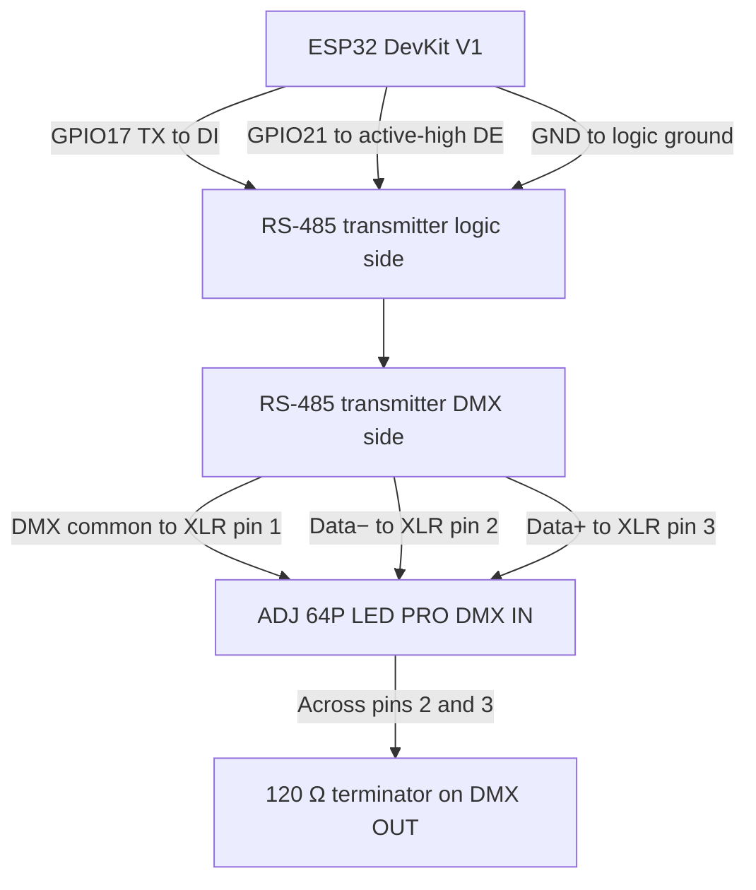

# Hardware and wiring

## Reference setup

| Item | Model and details | Status |
| --- | --- | --- |
| Matter controller | Homey Self-Hosted Server | Tested with dry-run firmware |
| Development board | ESP32 DevKit V1, 30-pin board with ESP-WROOM-32 module, ESP32-D0WDQ6-V3 revision 3.0 and 4 MB flash | Identified and flashed |
| USB serial | On-board Silicon Labs CP2102 and micro-USB data cable | Used for flashing and serial logs |
| DMX fixture | American DJ 64P LED PRO with 3-pin XLR DMX IN (male) and DMX OUT (female) | Identified from the fixture label and rear panel |
| DMX transmitter | RS-485 transmitter with 3.3 V-compatible logic and active-high driver enable. It must support 250 kbit/s and pass the DMX break. An isolated unit is preferred for permanent use. | Required for physical DMX. Exact module unconfirmed |
| DMX cable and termination | 120 Ω DMX cable with female 3-pin XLR at the fixture input, plus a 120 Ω terminator at the last fixture | Required for physical DMX |

## Wiring diagram

| Connection | What to check |
| --- | --- |
| GPIO17 (UART2 TX) → DI | Match the module's logic input voltage. The ESP32 uses 3.3 V logic. |
| GPIO21 → DE | This output goes high to enable transmission. For modules with separate receiver control, disable reception according to the module's datasheet. Leave the receiver output disconnected from the ESP32. |
| ESP32 GND → logic-side ground | For an isolated transmitter, keep the logic-side ground and the DMX-side common separate as directed by the module's datasheet. |
| Transmitter supply → module power input | Use the supply voltage and power wiring specified by the module vendor. A 3.3 V logic input does not establish the supply voltage. |
| DMX common, Data− and Data+ → XLR 1, 2 and 3 respectively | Check the numbered contacts and the module's documented polarity. A/B lettering and wire colors can be ambiguous. |
| Fixture DMX OUT → terminator | Fit a 120 Ω termination across data pins 2 and 3 at the last fixture. |

Power off the ESP32, transmitter and fixture while wiring. Use the RS-485 transmitter between the ESP32 and the XLR. The fixture runs from its own mains cable. Keep the work on the external low-voltage data connections and leave the fixture enclosure closed.

The reference fixture has a **male** DMX IN. Your cable needs a **female** end there. If using a breakout cable, verify each conductor against the numbered connector contact with a continuity meter.

## Set the fixture mode

Use the fixture's **MODE** button to select three-channel DMX mode. The ADJ manual shows the mode with a dot beneath the **last digit**. Set the start address to `001` with **UP/DOWN**.

| DMX slot at address 001 | Function |
| --- | --- |
| 1 | Red |
| 2 | Green |
| 3 | Blue |

The firmware scales all three channels for brightness and approximates white color temperature through RGB mixing. The other DMX slots are zero. Use the [physical build instructions](setup.md#5-add-physical-dmx) after wiring. The physical setup and electrical output remain to be validated on the bench.

- [American DJ 64P LED PRO manual, rev. 7/07, pages 6 and 9–10](https://www.ma-boite-a-archives.fr/BTS-SN/Cours/2015-2016/ActivitesEC2/Site_Materiel_Eclairage/res/64pledpro.pdf)
- [ESTA DMX512 guide](https://tsp.esta.org/tsp/documents/docs/DMX512-A_Guide_%288x10%29_ESTA.PDF)
